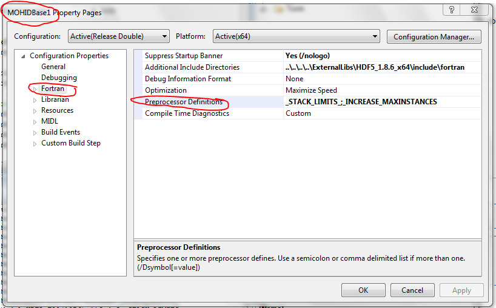

# Compilation preprocessor settings

During compilation of the MOHID source code, at preprocessing time, depending on the definition and values of preprocessor variables, different regions of the code will be compiled. Each preprocessor variable has a scope within the code where it is used. The scope of a preprocessor variable definition can be a single module or it can be the whole solution or only one project of the solution (such as Base1 or Base2).

The advanced MOHID user should be aware of the optional preprocessor settings as the released executables don't contain all the possibilities available and this obliges one to compile its own version of the MOHID executable under certain circumstances.



## Exclude modules

Some modules can be completely excluded from compilation. If your simulations do not use these modules you can use this pre-processor keywords.

```
Scope: MohidWater
```

```
_LAGRANGIAN_	   excludes Modules Lagrangian + Jet + Oil
_AIR_	           excludes Modules InterfaceWaterAir + Atmosphere
_WAVES_	           excludes Module Waves
_SEDIMENT_	   excludes Modules SedimentProperties + Consolidation
```

## Operating System options

Some parts of the program involves performing some actions at the filesystem level. This is inherent to the operating system. The default operating system is MS-Windows. To compile for the Linux operating system one must set the following preprocessor definition:

```
Scope: ConvertToHdf5, ConvertToXyz
```

```
_USE_NIX           Uses linux filesystem commands.
```

## Library Options

As the pre-built Netcdf library for windows x64 with the fortran binding is a rare bird to find, sometimes one may have to exclude the regions of code containing access to netcdf files.

```
Scope: MohidBase1, MohidBase2, ConvertToHdf5
```

```
_NO_NETCDF         Excludes regions of code that access netcdf files. To use when a pre-built netcdf library is unavailable.
```

## Performance options

Use this option if you want to nest several domains

```
Scope: global
```

```
_USE_MPI           includes MPI code
```

## Time Series Maximum Number of Columns in Character size

Default line_length of input/output ascii files such as TimeSeries is 256, however this can be a problem if the time series contains many many columns with many many properties and exceeds the 256 characters limit. Conveniently, this can be changed by defining the following preprocessor options

```
Scope: MohidBase1 (ModuleGlobalData)
```

```
_SHORT_LINE_LENGTH        sets line_length = 64
_LONG_LINE_LENGTH         sets line_length = 1024
_BIG_LINE_LENGTH          sets line_length = 6144
_EXTRA_LONG_LINE_LENGTH   sets line_length = 131072
_EXTRA_SHORT_LINE_LENGTH  sets line_length = 32
```

## Instances Management

MOHID is Object-Oriented (OO) in a centralized way, meaning that it has a central module that collects, registers and monitors every object instanciation. The downside is that it is limited to 500 instantiations of objects. Sometimes it is necessary to increase this number (this is true, in particular, when a high number of Tide gauges are used)

```
Scope: MohidBase1 (ModuleGlobalData)
```

```
_INCREASE_MAXINSTANCES  sets maximum number of object instances to 2000 (default is 500)
```

## Stack Management

Stack memory is limited to 1GB in all recent Windows versions (either 32 or 64 bits). Thus, it happens quite frequently that simulations that include the Waterquality or Life modules use stack extensively. One way to deal with [Stack limitations](stack-overflow.md) is by defining *Stack Reserve* in the linker options. However, when *Stack Reserve* fails, then removing some features of the software can help reduce the stack consumption. In particular, this option, when enabled, removes the calculation of the Minimum and Maximum attributes in the results in the HDF5 files.

```
Scope: MohidBase1 (ModuleHDF5)
```

```
_STACK_LIMITS_ disables the calculation of the Minimum and Maximum attributes in the results in the HDF5 files.
```

## Graphical options

```
Scope: MohidBase1 (ModuleGlobalData, ModuleHdf5)
```

```
_GUI_              includes GUI code
```

## Google maps compatible output

```
Scope: MohidBase2, MohidWater
```

```
_GOOGLEMAPS        Generates google compatible mapping coordinates
```

## Errors that may arise from incorrect preprocessor variables definition
