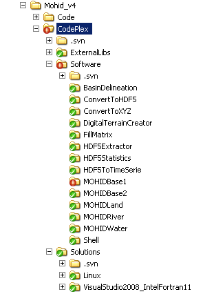
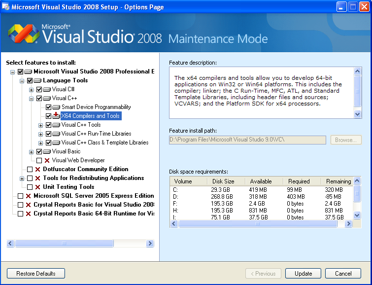
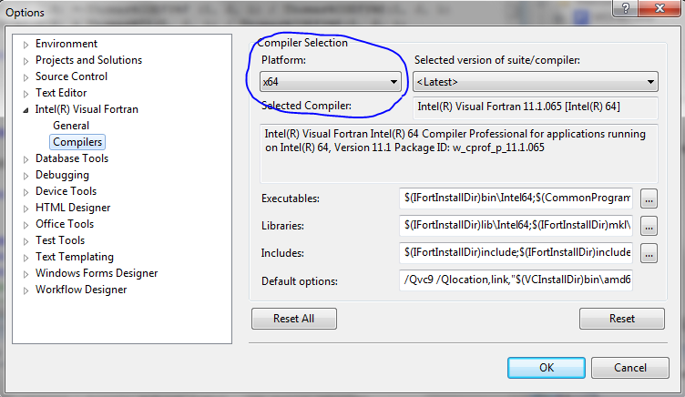
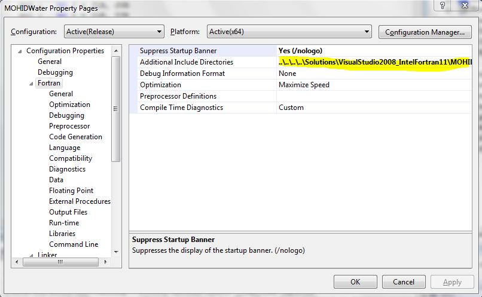
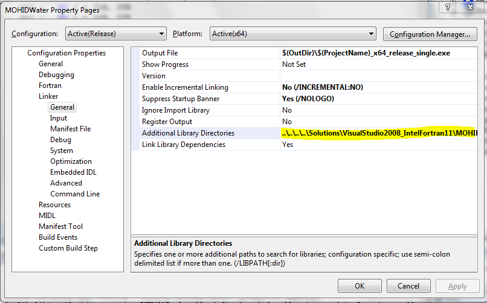
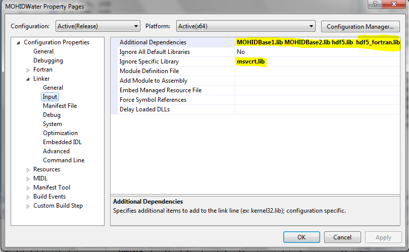

# Compiling with IFC 11

Please follow these instructions step by step and until the end:

## Creating a new project

1. Make sure you have installed in your computer Microsoft Visual Studio 2008 and Intel Fortran Compiler 11.1. If you don’t have both installed, please install them.
2. Make sure you have downloaded the last version of the code and solutions from codeplex (CodePlex or [http://mohid.codeplex.com](http://mohid.codeplex.com)) for example via tortoise software.
3. Your folder structure will look like this after the download:

    

    CodePlex local folder structure

4. Open Microsoft Visual Studio 2008.
5. Open the solution from the CODEPLEX structure above under folder > Solutions > VisualStudio2008_IntelFortran11
6. All the setting are already done.

## Build Solution

1. Select "Build...Build Solution"

## Build Solution in x64

### Pre-requisite

If it is the firt time you build for the x64 architecture, then you must first install the x64 platform on Visual Studio 2008.

1. Close any opened instance of Visual Studio 2008.
2. Load the dvd iso file of Visual Studio 2008 (found in \\\\kepler\\Software\\VS2008\\VisualStudio_Pro_2008_Eng.iso) with the [Daemon Tools](http://www.daemon-tools.cc/eng/home) utility. This will install a "virtual" dvd drive with Visual Studio 2008 loaded in your system files.
3. Go to *Control Panel --> Uninstall or change a program --> Microsoft Visual Studio 2008 Professional Edition --> Double click(win 7)|Add/Repair(win xp)*.
4. Install the *x64 Compiler tools* from the Visual Studio 2008 dvd.

    

    Visual Studion 2008 Installation Options

5. Open a new instance of Visual Studio 2008. Then select *Tools --> Options --> Intel Visual Fortran --> Compilers --> Platforms*. If the installation went ok, you should see a *x64* platform. Select it and then click *ok*. You are now able to select and compile any configuration of Intel Fortran projects with the x64 platform.

    

    Verifying the x64 architecture in Visual Studio project is available

    .

### Building Solution in x64

1. Select the [configuration](../programming/visual-studion-configuration.md) of choice (Debug, Release, Release Double, etc...).
2. Select the platform x64.

    

    Selecting the x64 archicture in a Visual Studio project

3. If the configuration isn't well configured please configure it as described below. Select *Build*... *Build Solution*.

#### Manually configuring a project configuration to build with x64 Hdf5 1.8.6 libraries.

These instructions are prepared for the MohidWater in the *Release* configuration for the *x64* platform, but the same steps can be reproduced for MohidLand and MohidRiver. Insert the text in bold in the yellow areas in your project as signaled in the images below.

- MohidBase1: **..\\..\\..\\..\\ExternalLibs\\HDF5_1.8.6_x64\\include\\fortran; ..\\..\\..\\..\\ExternalLibs\\Proj4\\Include**



*..\\..\\..\\..\\ExternalLibs\\HDF5_1.8.6_x64\\include\\fortran; ..\\..\\..\\..\\ExternalLibs\\Proj4\\Include*

- MohidBase2: **..\\..\\..\\..\\Solutions\\VisualStudio2008_IntelFortran11\\MOHIDNumerics\\MOHIDBase1\\x64\\Release**


*..\\..\\..\\..\\Solutions\\VisualStudio2008_IntelFortran11\\MOHIDNumerics\\MOHIDBase1\\x64\\Release*

.

- MohidWater: **..\\..\\..\\..\\Solutions\\VisualStudio2008_IntelFortran11\\MOHIDNumerics\\MOHIDBase1\\x64\\Release;**

**..\\..\\..\\..\\Solutions\\VisualStudio2008_IntelFortran11\\MOHIDNumerics\\MOHIDBase2\\x64\\Release;** **..\\..\\..\\..\\ExternalLibs\\HDF5_1.8.6_x64\\lib**


*..\\..\\..\\..\\Solutions\\VisualStudio2008_IntelFortran11\\MOHIDNumerics\\MOHIDBase1\\x64\\Release; ..\\..\\..\\..\\Solutions\\VisualStudio2008_IntelFortran11\\MOHIDNumerics\\MOHIDBase2\\x64\\Release; ..\\..\\..\\..\\ExternalLibs\\HDF5_1.8.6_x64\\lib*

**..\\..\\..\\..\\Solutions\\VisualStudio2008_IntelFortran11\\MOHIDNumerics\\MOHIDBase1\\x64\\Release; ..\\..\\..\\..\\Solutions\\VisualStudio2008_IntelFortran11\\MOHIDNumerics\\MOHIDBase2\\x64\\Release**



*..\\..\\..\\..\\Solutions\\VisualStudio2008_IntelFortran11\\MOHIDNumerics\\MOHIDBase1\\x64\\Release; ..\\..\\..\\..\\Solutions\\VisualStudio2008_IntelFortran11\\MOHIDNumerics\\MOHIDBase2\\x64\\Release*

**MOHIDBase1.lib MOHIDBase2.lib hdf5.lib hdf5_fortran.lib hdf5_f90cstub.lib zlib.lib libszip.lib** in *Additional Dependencies* and **msvcrt.lib** in *Ignore Specific Libraries*



*MOHIDBase1.lib MOHIDBase2.lib hdf5.lib hdf5_fortran.lib hdf5_f90cstub.lib zlib.lib libszip.lib* in *Additional Dependencies* and *msvcrt.lib* in *Ignore Specific Libraries*

### Present limitations for building some Mohid tool in x64 architecture in Windows

- Currently, only the Hdf5 1.8.6 libraries in 64bits are available in the [codeplex](../../archive/web/codeplex.md). The Proj4 and the [netcdf](../../archive/linux/netcdf.md) libraries in 64bits are currently unavailable on the [codeplex](../../archive/web/codeplex.md). This affects namely the [ConvertToHdf5](../../tools/converttohdf5.md), [Convert2netcdf](../../tools/convert2netcdf.md) and [ConvertToXYZ](../../tools/converttoxyz.md) tools.

## Optional compilation settings

1. To perform optional compilation, just add the compilation pre-processor keywords in "Properties...Fortran...PreProcessor", in the "Preprocessor Definitions" text box.

### Exclude modules

Some modules can be completely excluded from compilation. If your simulations do not use these modules you can use this pre-processor keywords.

```
_LAGRANGIAN_	   excludes Modules Lagrangian + Jet + Oil
_AIR_	           excludes Modules InterfaceWaterAir + Atmosphere
_WAVES_	           excludes Module Waves
_SEDIMENT_	   excludes Modules SedimentProperties + Consolidation
```

### Other options

Other keywords can also be used.

```
_USE_MPI           includes MPI code
_SHORT_LINE_LENGTH sets line_length = 64  (default line_length is 256)
_LONG_LINE_LENGTH  sets line_length = 1024(default line_length is 256)
_GUI_              includes GUI code
```

A more thorough explanation can be found on [compilation preprocessor settings](compilation-preprocessor-settings.md)
