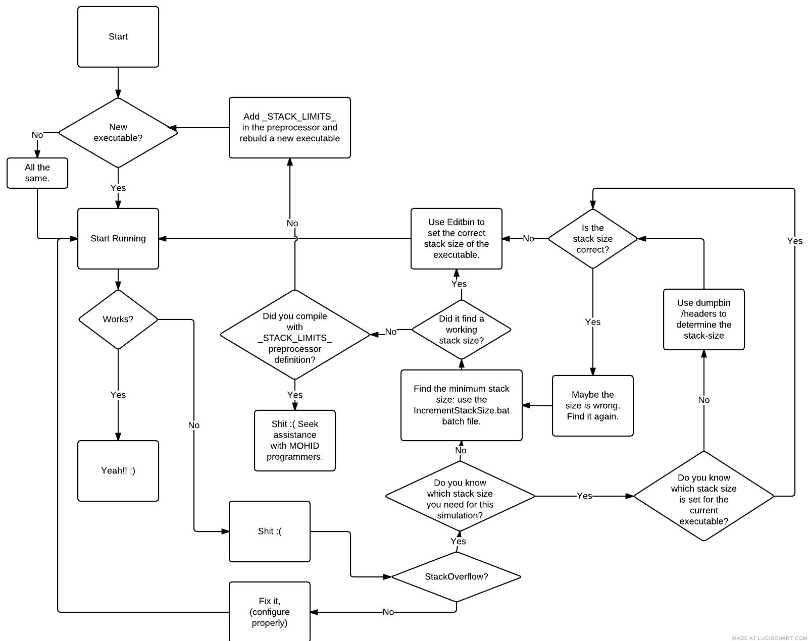

# Stack overflow

Stack overflows are a most recurrent problem in MOHID largest applications. In windows systems stack memory must be pre-reserved and is the memory where static data is loaded (passing arguments of calling functions, variables=). In windows systems (x32 or x64 architecture) static data is limited to 2GB only.

Here's a flow chart that helps you to determine the optimal stack size for your mohid application: [http://www.lucidchart.com/documents/view/4d9491c1-ba7c-4a5b-a974-4d630af9a3bf](http://www.lucidchart.com/documents/view/4d9491c1-ba7c-4a5b-a974-4d630af9a3bf)

["Before running Mohid" diagram](http://www.lucidchart.com/documents/view/4d9491c1-ba7c-4a5b-a974-4d630af9a3bf)

## Pre-requisites

You must have installed the following programs

- [Editbin](../programming/editbin.md)
- [Dumpbin](../../building/windows/dumpbin.md)
- [Stacksize](../programming/stacksize.md)
- [IncrementSizeOfStack](../../reference/incrementsizeofstack.md)
